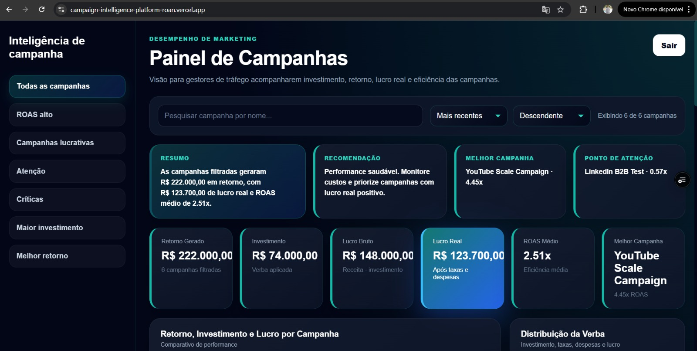
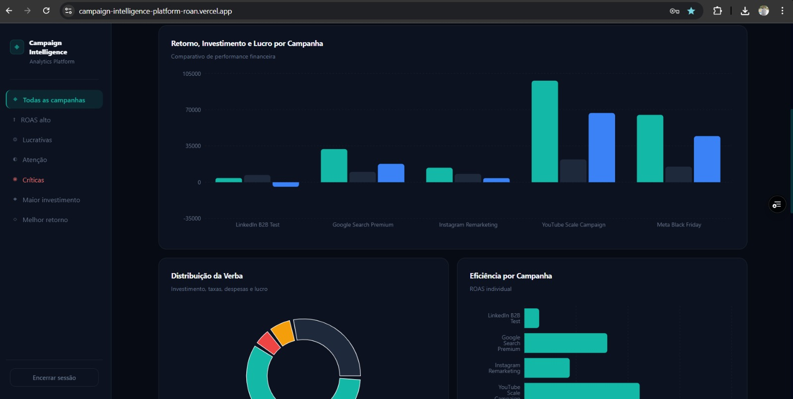
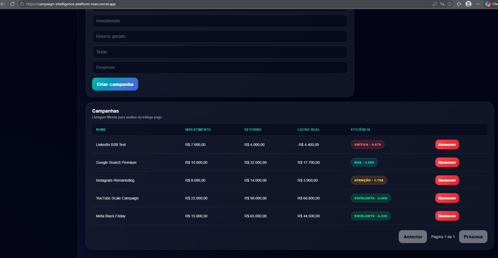

<h1 align="center">📊 Campaign Intelligence Platform</h1>

<p align="center">
  Aplicação <strong>fullstack</strong> para gestão inteligente de campanhas de marketing —
  com foco em <strong>backend</strong>, autenticação segura, regras de negócio no servidor
  e visualização estratégica de métricas em um <strong>dashboard interativo</strong>.
</p>

<p align="center">
  <a href="https://campaign-intelligence-platform-roan.vercel.app/"></a>
  <a href="https://campaign-intelligence-platform.onrender.com/health"></a>
</p>

<p align="center">
  
  
  
  
  
  
  
  
  
  
  
  
  
  
</p>

---

## 🔗 Links

| | URL |
|---|---|
| 🌐 **Frontend** | https://campaign-intelligence-platform-roan.vercel.app/ |
| ⚙️ **Backend API** | https://campaign-intelligence-platform.onrender.com/ |
| 💚 **Health Check** | https://campaign-intelligence-platform.onrender.com/health |

**👤 Usuário de teste:** `gabriel@email.com` · senha `123456` — ou crie uma conta direto na aplicação.

> ⚠️ O backend roda no plano gratuito do **Render**. Se estiver inativo, a **primeira requisição** pode levar alguns segundos enquanto o servidor "acorda".

## 📸 Preview

|  |  |
|:---:|:---:|
| **Login** | **Dashboard** |
|  |  |
| **Gráficos de performance** | **Gestão de campanhas** |
|  |  |

## 🎯 Sobre o projeto

Desenvolvido como **desafio técnico com foco em backend**, demonstrando na prática:

- APIs **RESTful** com **TypeScript**
- Autenticação **JWT** + hashing de senha
- Persistência com **Prisma ORM**
- **Regras de negócio no servidor** (métricas calculadas no backend, nunca no cliente)
- Integração completa **frontend ↔ backend** com visualização estratégica de métricas

## ✨ Funcionalidades

| Área | O que faz |
|---|---|
| 🔐 **Autenticação** | Cadastro, login com **JWT**, rotas protegidas, middleware de auth, senha com **bcrypt** |
| 📁 **Campanhas** | Cadastro, listagem **paginada**, busca por nome, ordenação dinâmica, exclusão, filtros |
| 📊 **Dashboard** | KPIs financeiros, **ROAS médio**, lucro bruto/real, melhor campanha, ranking, gráficos e **insights automáticos** |
| 🛡️ **Segurança** | Validação com **Zod**, rate limiting, middleware global de erros, logger de requisições, health check |

## 📐 Regras de negócio

> Todas as métricas financeiras são calculadas **no backend**, garantindo consistência.

| Métrica | Fórmula |
|---|---|
| **Lucro Bruto** | Receita − Custo |
| **Lucro Real** | Receita − Custo − Taxas − Despesas |
| **ROAS** | Receita ÷ Custo |

## 🔌 Endpoints

| Método | Rota | Descrição | Auth |
|---|---|---|:---:|
| `POST` | `/auth/register` | Registrar usuário | — |
| `POST` | `/auth/login` | Login (retorna JWT) | — |
| `POST` | `/campaigns` | Criar campanha | 🔒 |
| `GET` | `/campaigns` | Listar (paginação, busca, ordenação) | 🔒 |
| `DELETE` | `/campaigns/:id` | Remover campanha | 🔒 |
| `GET` | `/health` | Health check da API | — |

**Query params** de `GET /campaigns`: `page` · `limit` · `search` · `sortBy` · `order` (`asc`/`desc`)

```
GET /campaigns?page=1&limit=10&search=meta&sortBy=roas&order=desc
```

## 🛠️ Stack

**Backend:** Node.js · TypeScript · Express · Prisma ORM · SQLite · JWT · bcrypt · Zod · Express Rate Limit · Vitest · Supertest
**Frontend:** React · TypeScript · Vite · Recharts · React Hot Toast
**DevOps:** GitHub Actions (CI/CD) · Render · Vercel

## 📦 Estrutura

```
campaign-intelligence-platform
├── .github/workflows/ci.yml     # pipeline de CI/CD
├── backend
│   ├── prisma/                   # schema, migrations, seed
│   ├── src/                      # middlewares, routes, schemas, services, utils
│   └── tests/                    # auth.test.ts, health.test.ts
└── frontend
    └── src/                      # App, main, assets
```

## 🚀 Como rodar localmente

```bash
git clone https://github.com/gabrieltrisi/campaign-intelligence-platform.git
cd campaign-intelligence-platform
```

**Backend** — crie `backend/.env`:

```env
PORT=3333
JWT_SECRET=your_secret
DATABASE_URL="file:./dev.db"
FRONTEND_URL=http://localhost:5173
```

```bash
cd backend && npm install
npx prisma migrate dev      # migrations
npm run seed                # dados iniciais
npm run dev                 # http://localhost:3333
```

**Frontend** — crie `frontend/.env` com `VITE_API_URL=http://localhost:3333`:

```bash
cd frontend && npm install && npm run dev   # http://localhost:5173
```

## 🧪 Testes & CI/CD

```bash
cd backend && npm run test   # Vitest + Supertest
```

Cobertura: autenticação, health check, respostas/status HTTP, integração entre rotas e middleware de proteção.
A pipeline (**GitHub Actions**, `.github/workflows/ci.yml`) instala dependências, builda o backend, roda os testes e valida a estabilidade **antes do deploy**.

## 🔐 Segurança

JWT Authentication · hashing com **bcrypt** · middleware de autenticação · rotas protegidas · validação com **Zod** · **rate limiting** · error handling global · sanitização de entrada.

**Health check** — `GET /health`:

```json
{ "status": "healthy", "database": "connected", "version": "1.0.0" }
```

## 🧠 Decisões técnicas

- **TypeScript** no backend para segurança e previsibilidade de tipos.
- **Prisma** para modelagem e persistência ágil dos dados.
- **SQLite** por simplicidade de execução local (produção evolui para PostgreSQL).
- Métricas de negócio **calculadas no backend** para garantir consistência entre clientes.
- Frontend consome a API **autenticado** e exibe os dados de forma visual e estratégica.

## 🗺️ Melhorias futuras

Refresh token · exportação de relatórios · PostgreSQL em produção · Docker · testes E2E · WebSockets · multi-tenant · tema dinâmico · observabilidade e logs centralizados.

---

**Autor:** Gabriel Trisi · [github.com/gabrieltrisi](https://github.com/gabrieltrisi)

<sub>© 2026 Gabriel Trisi — Todos os direitos reservados. Código público apenas para avaliação (portfólio); uso, cópia ou redistribuição não autorizados. Ver <a href="./COPYRIGHT">COPYRIGHT</a>.</sub>
